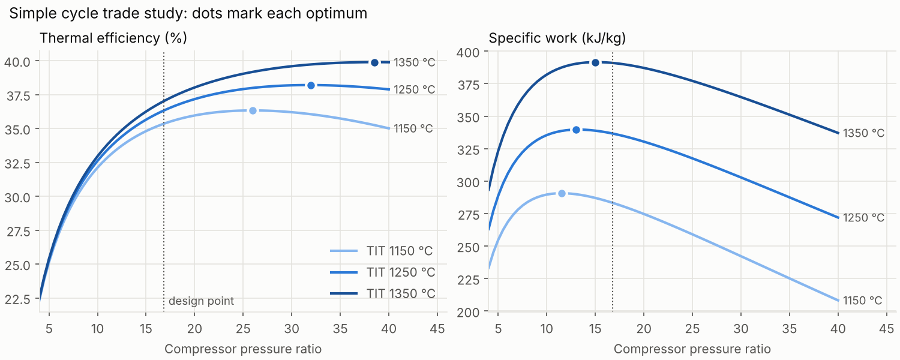
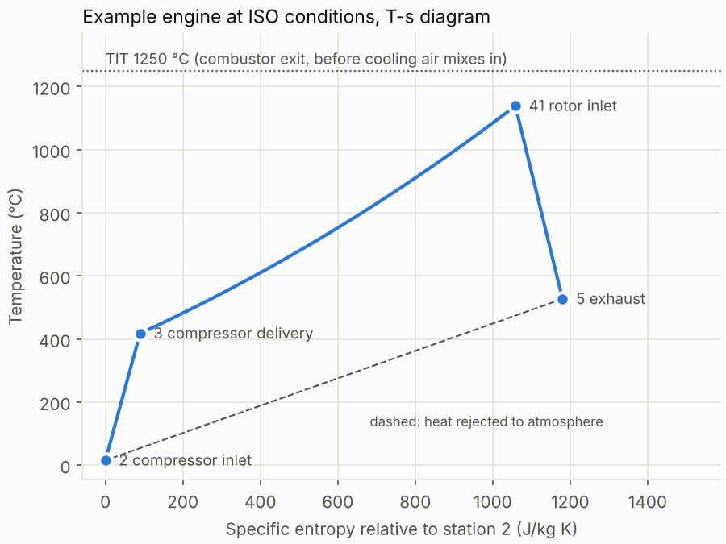

# gtperf

A Python toolkit for gas turbine performance: cycle modelling, site performance prediction, pass-off test validation and fleet trend analysis.

**Status:** phase 1 of 6 (design-point simple-cycle model). Private, work in progress.

## What phase 1 does

- **Real-gas properties.** Humid air and combustion products as ideal-gas mixtures, using NASA 7-coefficient polynomials (GRI-Mech 3.0 data). Enthalpies include heats of formation, so fuel LHV and the combustor energy balance come out of the same property model. Checked against Cantera to 1 part in a million.
- **Fuels.** Gaseous hydrocarbon blends (CH4, C2H6, C3H8 with CO2/N2 inerts), complete combustion, LHV and stoichiometric fuel-air ratio computed from composition.
- **Components.** Inlet duct, compressor (isentropic or polytropic efficiency), combustor (solves fuel flow for a target exit temperature, with pressure loss and combustion efficiency), turbine, and a simple turbine cooling-air model that separates TIT (combustor exit) from rotor inlet temperature.
- **Single-shaft simple cycle.** Station-by-station results, shaft and electrical power, thermal efficiency, heat rate, exhaust flow and temperature, inlet and exhaust installation losses, and sizing of air flow for a target output.
- **Parametric studies** over pressure ratio and firing temperature.
- **CLI** driven by a TOML engine definition.

## Quick start

```bash
pip install -e ".[dev]"
gtperf design examples/engine_13mw.toml       # or: python -m gtperf design ...
python examples/parametric_study.py           # regenerates docs/figures/
pytest
```

Example output for the illustrative 13 MW class engine at ISO conditions (15 °C, 1.01325 bar, 60 % RH):

```
electrical_power_MW             12.929
thermal_efficiency_pct          36.311
heat_rate_kJ_per_kWh          9914.356
exhaust_flow_kg_s               39.750
exhaust_temp_C                 527.001
```

From Python:

```python
from gtperf import SimpleCycle, Compressor, Combustor, Turbine, Ambient, natural_gas

cycle = SimpleCycle(
    Compressor(pressure_ratio=16.8, efficiency=0.90),        # polytropic
    Combustor(natural_gas(), t_out=1523.15),                 # TIT 1250 C
    Turbine(efficiency=0.89),
    cooling_fraction=0.15,
)
iso = cycle.run(air_flow=39.0)
hot = cycle.run(air_flow=39.0, ambient=Ambient(t=308.15))   # 35 C day
print(iso, hot.electrical_power / 1e6)
```

## Results



The classic simple-cycle trade-off: specific work (and so engine size for a given output) peaks at a much lower pressure ratio than thermal efficiency does, and both rise with firing temperature. Small industrial engines sit between the two optima.



## Verification

The tests in `tests/` check:

| Check | Reference |
|-------|-----------|
| Constant-cp cycle with separate air and gas properties matches the hand calculation to 1e-6 | Textbook method (Saravanamuttoo, *Gas Turbine Theory*, ch. 2) |
| Lossless cycle recovers the ideal Brayton efficiency 1 − r^−(γ−1)/γ | Analytical |
| First law closes across the whole engine to 1e-9, with cooling air | Energy balance |
| Mass and element balances through the combustor | Conservation |
| Air cp at 300, 500, 1000 K within 0.5 % | Ideal-gas air tables |
| Methane LHV 50.0 MJ/kg, stoichiometric AFR 17.2 | Published values |
| Mixture cp, h and s identical to Cantera | Cantera / GRI-Mech 3.0 |
| Expected trends: TIT, pressure ratio optima, hot day, installation losses | Physical behaviour |

## Limitations (phase 1)

- Design point only. The hot-day result holds air flow constant; real engines lose flow on a hot day, which needs compressor and turbine maps (phase 2).
- Cooling air is a single mixed stream ahead of the turbine, not a stage-by-stage model.
- The example engine uses illustrative inputs and has not yet been calibrated against a published datasheet (phase 2).

## Roadmap

1. **Design-point cycle** (this release)
2. Off-design matching with component maps, ambient corrections and site performance sheets, calibrated to a public datasheet
3. Pass-off test validation: correction to reference conditions (ASME PTC 22 / ISO 2314 approach) and measurement uncertainty (GUM, Monte Carlo)
4. Fleet analytics: SPC charts, gas-path fault isolation, anomaly detection on a synthetic fleet
5. Tooling and reporting: Excel/VBA front end, CI, technical report
6. Stretch: MATLAB port, two-spool aero cycle, requirements and certification note

All data in this project is synthetic or from public sources.
