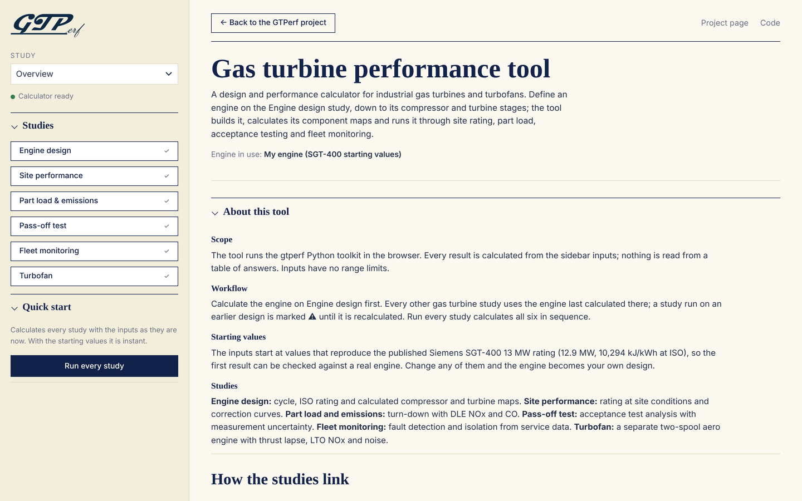
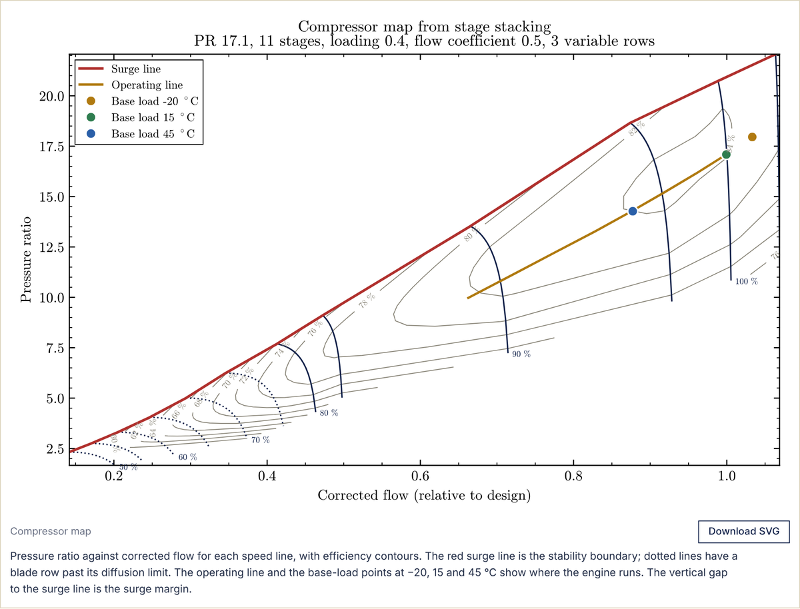

# gtperf


An open design and research tool for gas turbine performance. You set the cycle and the blade-stage design, and GTPerf builds the engine, calculates its compressor and turbine maps, and follows it through site rating, part load, emissions, acceptance testing and fleet monitoring.

**[Try it in your browser](https://tanishq-charde.github.io/gtperf-app/)** (nothing to install) · **[User manual](docs/GTPerf_User_Manual.pdf)** · [Changelog](CHANGELOG.md)

v1.3.0, beta. 153 tests. All data is synthetic or from public sources.



## What it does

| Study | What you get |
|---|---|
| Engine design | A twin-shaft industrial engine built from your design values, its ISO rating, and compressor and turbine maps generated by mean-line stage stacking |
| Site performance | Rating at any site, broken into correction factors, plus correction curves against ambient temperature |
| Part load and emissions | Turndown with the control limits, DLE NOx and CO against the Medium Combustion Plant Directive |
| Pass-off test | A simulated acceptance test to ASME PTC 22 / ISO 2314 with GUM and Monte Carlo uncertainty, scored against a hidden true engine |
| Fleet monitoring | Production SPC, gas-path analysis and fault detection across a synthetic fleet |
| Turbofan | A two-spool engine with thrust lapse, generated maps, LTO NOx against CAEP/6 and CAEP/8, and noise sources |

The design inputs start at values that reproduce the published Siemens Energy SGT-400 13 MW rating (12.89 MW and 10,299 kJ/kWh against 12.9 MW and 10,294 kJ/kWh), so the baseline can be checked against a real engine before you change it.

## Install and run

```bash
pip install -e ".[dev]"
gtperf gui                                      # opens the web tool
gtperf design examples/engine_13mw.toml         # design-point cycle
gtperf site examples/sgt400_13mw.toml examples/site_hot_desert.toml
gtperf turbofan examples/turbofan_cruise.toml
make check                                      # lint, tests and coverage
```

The `examples/` folder has a script for each study (pass-off test, fleet analysis, turbofan trades, emissions and more). From Python:

```python
from gtperf import SimpleCycle, Compressor, Combustor, Turbine, Ambient, natural_gas

cycle = SimpleCycle(
    Compressor(pressure_ratio=16.8, efficiency=0.90),
    Combustor(natural_gas(), t_out=1523.15),
    Turbine(efficiency=0.89),
    cooling_fraction=0.15,
)
iso = cycle.run(air_flow=39.0)
hot = cycle.run(air_flow=39.0, ambient=Ambient(t=308.15))  # 35 °C day
```

## Selected results

**Calibration.** Against the SGT-400 datasheet, power, heat rate and exhaust flow are fitted. Exhaust temperature is not fitted and comes out at 550.3 °C against the datasheet 555 °C.

**Pass-off uncertainty.** Repeating the test 100 times with fresh biases, noise and weather, the truth falls inside the stated 95 % interval 93 to 97 % of the time for all four corrected results. See the [example report](docs/passoff/report.md).

**Fleet monitoring.** On an unseen fleet, all 5 injected faults are detected and correctly named, with no false alarms in 24 engine-years. See the [fleet report](docs/fleet/report.md).



## Repository layout

| Path | Contents |
|---|---|
| `src/gtperf/` | The models: gas properties, components, cycles, maps (`mapgen.py`), site, pass-off, fleet, turbofan, emissions |
| `web/` | The web tool. `make web` builds `web/dist/index.html`, which runs the package in the browser through Pyodide |
| `examples/` | One script per study |
| `docs/` | User manual, [verification](docs/verification.md), [requirements and certification](docs/requirements_and_certification.md) and study write-ups |
| `excel/`, `matlab/` | Excel site tool with VBA, and a MATLAB port checked against Python |
| `tests/` | The test suite |

## Limitations

- The maps come from a one-dimensional mean-line model. They show how stage choices shape a map, not a validated map of a real compressor.
- There is no real engine data. Test, calibration and fleet studies run on synthetic data, so they demonstrate the methods, not this engine's numbers.
- Some inputs are illustrative, including the turbofan NOx reference index and the calibration certificates.
- Noise is given as source levels, not certification EPNdB, and there is no aero CO model.
- Fault isolation assumes one fault at a time.

Feedback and suggestions are welcome through issues.
