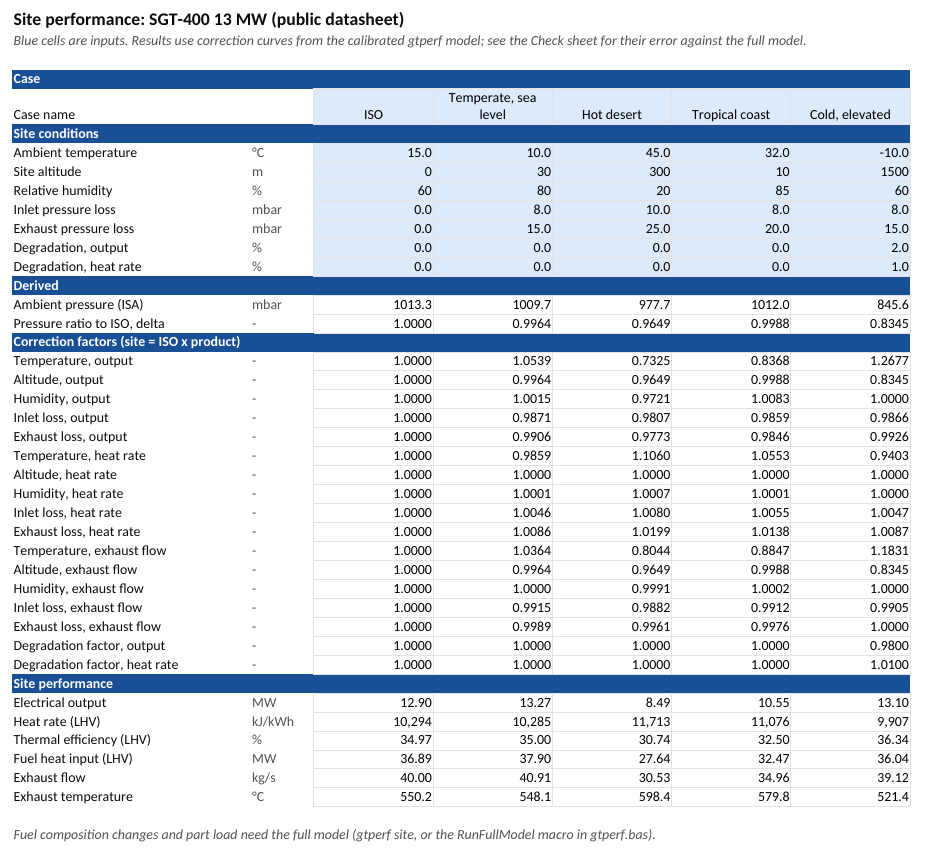
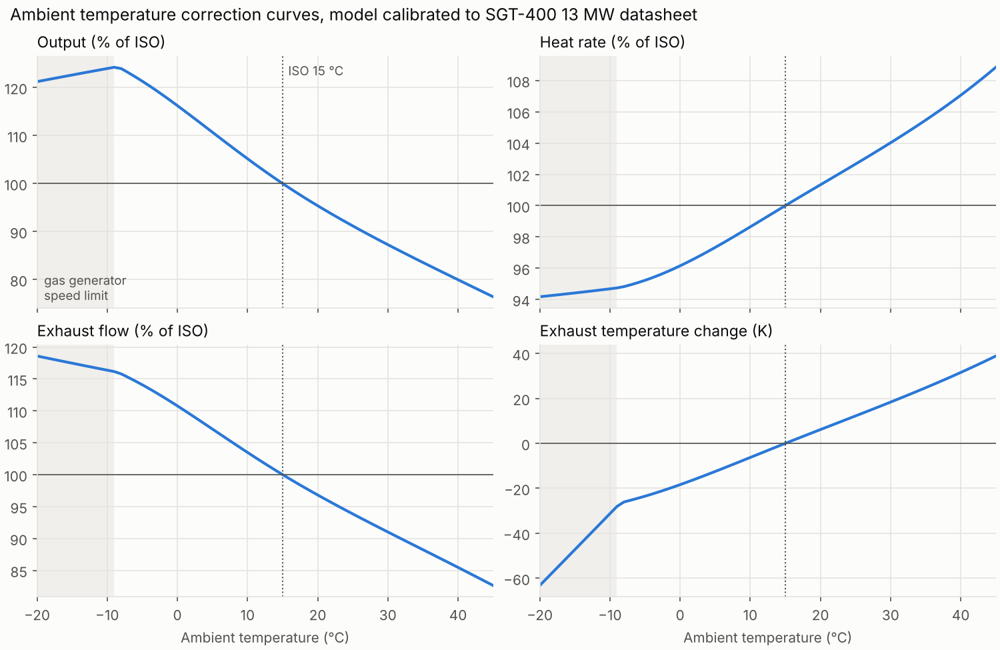
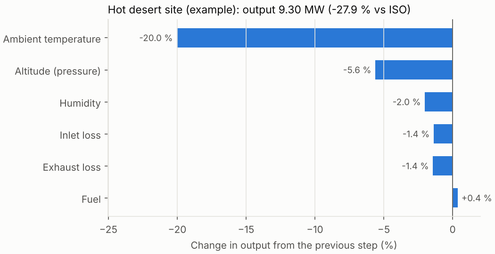
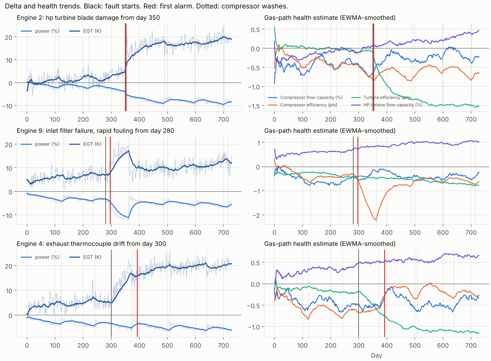

# gtperf

A Python toolkit for gas turbine performance: cycle modelling, site performance prediction, pass-off test validation and fleet trend analysis.

**Status:** v1.0.0. Phases 1 to 5 of 6 done (design-point cycle; off-design and site performance; pass-off test validation; fleet analytics; tooling and reporting). Private.

## What phase 1 does

- **Real-gas properties.** Humid air and combustion products as ideal-gas mixtures, using NASA 7-coefficient polynomials (GRI-Mech 3.0 data). Enthalpies include heats of formation, so fuel LHV and the combustor energy balance come out of the same property model. Checked against Cantera to 1 part in a million.
- **Fuels.** Gaseous hydrocarbon blends (CH4, C2H6, C3H8 with CO2/N2 inerts), complete combustion, LHV and stoichiometric fuel-air ratio computed from composition.
- **Components.** Inlet duct, compressor (isentropic or polytropic efficiency), combustor (solves fuel flow for a target exit temperature, with pressure loss and combustion efficiency), turbine, and a simple turbine cooling-air model that separates TIT (combustor exit) from rotor inlet temperature.
- **Single-shaft simple cycle.** Station-by-station results, shaft and electrical power, thermal efficiency, heat rate, exhaust flow and temperature, inlet and exhaust installation losses, and sizing of air flow for a target output.
- **Parametric studies** over pressure ratio and firing temperature.
- **CLI** driven by a TOML engine definition.

## What phase 2 adds

- **Twin-shaft cycle** (gas generator plus free power turbine), the layout of most small industrial engines, alongside the single-shaft cycle.
- **Off-design matching.** A generic analytic compressor map (speed lines from surge to choke, efficiency fall-off with speed and incidence), Stodola ellipse-law turbine flow capacity, and turbine efficiency against blade-speed ratio. A Newton solver finds the point where compressor flow, both turbine capacities and the gas generator power balance agree. Corrected flow and speed use full γRT similarity, so humidity and fuel changes are handled consistently.
- **Base-load control.** Constant TIT, with a gas generator speed limit that takes over on cold days and lowers TIT ("speed topping").
- **Calibration to a public datasheet.** Air flow, TIT and turbine efficiency are fitted to the published SGT-400 13 MW ISO power, heat rate and exhaust flow. Exhaust temperature is left out of the fit and used as an independent check.
- **Site performance prediction.** ISA altitude, ambient temperature, humidity, inlet and exhaust losses, fuel composition and component degradation, with the change from ISO broken into correction factors that multiply exactly to the site value. Output as a markdown or CSV performance sheet.
- **Correction curves** across ambient temperature, plus a `Health` object (compressor flow and efficiency, turbine efficiency and capacity) that phases 3 and 4 build on.

## What phase 3 adds

- **Synthetic test-bed data.** A production engine with hidden build-to-build health deltas is "tested" at whatever the weather is on the day. A representative instrument set (redundant inlet RTDs, 12 exhaust thermocouples, Coriolis fuel flow, gas chromatograph LHV, power metering, barometer, humidity, inlet and exhaust pressure losses) logs at 1 Hz. Every sensor gets a hidden calibration bias and noise, and faults can be injected: offset, drift, stuck and spikes.
- **Data validation.** Spike removal (rolling median and MAD), stuck-sensor detection, redundant-sensor disagreement, exhaust thermocouple deviation and drift checks against the rest of the rake, and stability criteria on 1-minute averages.
- **Correction to reference conditions** by the model-ratio method used in performance test codes (ASME PTC 22 / ISO 2314 style). Exhaust flow is derived from a heat balance, since it cannot be measured directly.
- **Measurement uncertainty.** GUM first-order propagation with numerical sensitivities through the whole correction chain, plus a JCGM 101 Monte Carlo. Calibration errors are shared by all test points and random errors are independent per point, with an autocorrelation-corrected standard error. The budget also includes exhaust profile under-sampling when thermocouples are excluded, and correction-model uncertainty from production scatter.
- **Acceptance** against guarantee limits with guarded-band verdicts and probability of conformance. A test point is flagged as not valid when the engine ran in a different control mode from the reference (detected from measured gas generator speed).
- **Auto-generated test report** in markdown with figures.

## What phase 4 adds

- **Production SPC.** 200 synthetic pass-off results in build order with hidden events: a damaged engine, a test-bed metering error and a supplier change. The toolkit runs individuals, EWMA and CUSUM charts, Western Electric rules, a robust Phase I and Cpk against the acceptance limit.
- **Gas-path analysis.** An influence coefficient matrix taken from the engine model, weighted least-squares health estimation, fault fingerprints for components and sensors, sensor isolation by residual, and a nonlinear Gauss-Newton refit for large deviations.
- **In-service fleet monitoring.** A synthetic fleet of 12 engines over 2 years, with compressor fouling and washes, wear, UK-like weather and five injected engine and instrument faults. Each snapshot is compared with the nominal model through a baseline lookup. Two physics-based detectors run on the results: a trend-compensated step detector with an exact chi-squared statistic, and an instrument consistency monitor. Thresholds are tuned on one fleet and scored on an unseen one, against a naive data-driven detector.

## What phase 5 adds

- **Excel site performance tool.** `gtperf excel` writes a workbook for a non-specialist: five site cases side by side, input range checks, every correction factor visible, and the results. It uses plain formulas over correction tables generated from the full model, so it needs no Python and no macros, and stays within 0.2 % of the full model. See [excel/README.md](excel/README.md).
- **VBA module.** [excel/gtperf.bas](excel/gtperf.bas) adds worksheet functions (`GT_SITE`, `GT_ISA_PRESSURE` and others) and a `RunFullModel` macro that sends each case to the Python model.
- **Automated checks.** Ruff lint, 80 tests with 95 % line and branch coverage (`make check`), and a GitHub Actions workflow ready for when the repository is published. The workbook formulas and the VBA functions are tested by recalculating and running them in headless LibreOffice.
- **Technical report and slide deck**, kept as private documents outside the repository.



## Quick start

```bash
pip install -e ".[dev]"
gtperf design examples/engine_13mw.toml       # or: python -m gtperf design ...
python examples/parametric_study.py           # regenerates docs/figures/
gtperf calibrate examples/sgt400_13mw.toml
gtperf site examples/sgt400_13mw.toml examples/site_hot_desert.toml
gtperf curves examples/sgt400_13mw.toml > curves.csv
gtperf excel examples/sgt400_13mw.toml site_tool.xlsx
python examples/site_performance.py           # correction curves, site sheet
python examples/passoff_test.py               # synthetic pass-off test and report
python examples/coverage_study.py 100         # does U95 really cover 95 %?
python examples/fleet_analysis.py             # production SPC and fleet monitoring (a few minutes)
make check                                    # lint, tests and coverage
```

Example output for the illustrative 13 MW class engine at ISO conditions (15 °C, 1.01325 bar, 60 % RH):

```
electrical_power_MW             12.929
thermal_efficiency_pct          36.311
heat_rate_kJ_per_kWh          9914.356
exhaust_flow_kg_s               39.750
exhaust_temp_C                 527.001
```

From Python:

```python
from gtperf import SimpleCycle, Compressor, Combustor, Turbine, Ambient, natural_gas

cycle = SimpleCycle(
    Compressor(pressure_ratio=16.8, efficiency=0.90),        # polytropic
    Combustor(natural_gas(), t_out=1523.15),                 # TIT 1250 C
    Turbine(efficiency=0.89),
    cooling_fraction=0.15,
)
iso = cycle.run(air_flow=39.0)
hot = cycle.run(air_flow=39.0, ambient=Ambient(t=308.15))   # 35 C day
print(iso, hot.electrical_power / 1e6)
```

## Results


The classic simple-cycle trade-off: specific work (and so engine size for a given output) peaks at a much lower pressure ratio than thermal efficiency does, and both rise with firing temperature. Small industrial engines sit between the two optima.


### Calibration to the SGT-400 13 MW datasheet

Datasheet values from the [Siemens Energy SGT-400 product page](https://siemens-energy.com/us/en/home/products-services/product/sgt-400.html) (simple cycle, 13 MW version, ISO). Compressor polytropic efficiency 0.89, 15 % cooling air, 4 % combustor loss and 98 % generator efficiency are assumptions.

| Quantity | Datasheet | Model | Error |
|---|---:|---:|---:|
| Electrical power (MW) | 12.9 | 12.9 | fitted |
| Heat rate (kJ/kWh) | 10,294 | 10,294 | fitted |
| Exhaust flow (kg/s) | 40.0 | 40.0 | fitted |
| Exhaust temperature (°C) | 555 | 550.2 | −4.8 K (not fitted) |

Fitted values: air flow 39.2 kg/s, TIT 1280 °C, turbine isentropic efficiency 0.858. These depend on the assumptions above, so they are model parameters, not claims about the real engine.



Output falls by about 0.9 % per kelvin above ISO, while heat rate and exhaust temperature rise. Below about −6 °C the gas generator reaches its speed limit (shaded), so TIT is cut back and the curves change slope.



The full sheet for this example site is in [docs/site_hot_desert.md](docs/site_hot_desert.md).

### Pass-off test example

[docs/passoff/report.md](docs/passoff/report.md) is the generated report for engine ESN-0412. It was tested on an 8 to 9 °C day with four injected sensor faults, and the raw log is alongside it. Validation catches all four faults, and the engine passes all three limits. Because the data is synthetic, the report ends by comparing the corrected results with the hidden truth: every result lands within its U95.


### Does the stated uncertainty mean what it says?

`examples/coverage_study.py` repeats the test 100 times with fresh biases, noise, engine health and weather, and counts how often the truth falls inside the 95 % interval.

The first version covered only 80 % for corrected power. The cause was the correction itself, not the instruments. The correction curves describe the nominal engine, but every production engine responds slightly differently to ambient conditions. The error was worst on cold days, when a slightly different engine hits the gas generator speed limit at a different temperature. Two fixes followed: a correction-model uncertainty term driven by production scatter, and a check that refuses tests run in a different control mode from the reference. With those in place:

| Result | Coverage of U95 (valid tests) | Std of normalised error |
|---|---:|---:|
| Corrected power | 95.5 % | 0.92 |
| Corrected heat rate | 98.9 % | 0.96 |
| Corrected exhaust temperature | 94.4 % | 1.07 |
| Corrected exhaust flow | 97.8 % | 0.99 |

89 of the 100 tests were valid; 11 were flagged for running on the speed limit.

### Fleet analytics results

Full write-up: [docs/fleet/report.md](docs/fleet/report.md).

- **Production.** The CUSUM chart flags the supplier change 6 builds after it happens and EWMA after 7, while the Shewhart chart needs 28. Gas-path analysis of the shift points to compressor efficiency, which is the true cause. Cpk against the acceptance limit falls from 1.51 to 1.03.
- **In service (unseen test fleet).** All 5 faults are detected and all 5 correctly named: turbine blade damage, nozzle erosion, inlet filter failure, a drifting exhaust thermocouple and a fuel meter error. There are no false alarms in 24 engine-years. The naive detector also finds the faults, but it cannot name them and raises 0.75 nuisance alarms per engine-year.



Getting there took three fixes, each found by looking at false alarms:

1. Compressor washes had to be modelled as steps in each engine's trend.
2. The test statistic had to use the true prediction variance of the trend fit and the correlated error from the ambient temperature sensor.
3. Large genuine faults had to be refitted with the nonlinear model before being blamed on an instrument.

## Verification

The tests in `tests/` check:

| Check | Reference |
|-------|-----------|
| Constant-cp cycle with separate air and gas properties matches the hand calculation to 1e-6 | Textbook method (Saravanamuttoo, *Gas Turbine Theory*, ch. 2) |
| Lossless cycle recovers the ideal Brayton efficiency 1 − r^−(γ−1)/γ | Analytical |
| First law closes across the whole engine to 1e-9, with cooling air | Energy balance |
| Mass and element balances through the combustor | Conservation |
| Air cp at 300, 500, 1000 K within 0.5 % | Ideal-gas air tables |
| Methane LHV 50.0 MJ/kg, stoichiometric AFR 17.2 | Published values |
| Mixture cp, h and s identical to Cantera | Cantera / GRI-Mech 3.0 |
| Expected trends: TIT, pressure ratio optima, hot day, installation losses | Physical behaviour |
| Off-design solver reproduces the design point to 1e-8 (single and twin shaft) | Consistency |
| Dry-air output scales exactly with ambient pressure; heat rate unchanged | Non-dimensional similarity |
| Cold day switches to gas generator speed control and lowers TIT | Control logic |
| Hot day: lower output and flow, higher heat rate and exhaust temperature, less surge margin | Physical behaviour |
| Site correction factors multiply exactly to the site/ISO ratio | Consistency |
| Calibration hits datasheet targets; exhaust temperature within 10 K | SGT-400 datasheet |
| With perfect instruments, the correction returns the model reference values | Consistency |
| Validation catches every injected fault and raises no flags on clean data | Synthetic faults |
| Corrected results fall within U95 of the hidden truth | Synthetic truth |
| GUM and Monte Carlo standard uncertainties agree within 15 % | JCGM 100 / 101 |
| Speed-limited cold-day test is flagged as not valid | Control-mode check |
| CUSUM and EWMA detect a 1-sigma shift sooner than Shewhart | SPC theory |
| Linear GPA recovers health exactly from linear deltas; isolates a sensor bias | Consistency |
| Nonlinear GPA explains a large fault that linear GPA cannot | Engine model |
| Baseline lookup matches the engine model to 0.05 % | Consistency |
| Small fleet: step fault and sensor fault both detected and correctly isolated | Synthetic truth |
| Excel correction method within 0.3 % of the full model, on and off the table grid | Full model |
| Workbook formulas (recalculated in LibreOffice) and VBA functions (run in its VBA mode) match the Python mirror to 1e-9 | Consistency |
| VBA site-file writer and CSV reader round-trip through the real CLI | Consistency |

## Limitations

- The compressor map is generic and analytic, not the real machine's. Trends are right but numbers away from ISO are indicative only. No variable inlet guide vanes or bleed schedules yet, so surge margin falls further on hot days than a real engine would allow.
- The calibration fits three datasheet numbers with three unknowns. A real calibration would use test-bed data across several operating points.
- Cooling air is a single mixed stream ahead of the HP turbine, not a stage-by-stage model.
- Inlet and exhaust losses are fixed at the quoted values rather than scaling with flow squared.
- The twin-shaft humidity effect (about +5 % output from dry to saturated at 40 °C) comes from the gas generator speeding up with more water vapour in the gas. It has not been checked against OEM humidity curves.
- Part load, generator capability limits and other derates are not modelled yet.
- Pass-off instrument uncertainties and production scatter are representative assumptions. A real test would take them from calibration certificates and fleet build data.
- The exhaust temperature profile in the synthetic data is a fixed pattern. Real profiles shift with load and combustor condition.
- Compressor and turbine efficiency faults have nearly identical fingerprints with this measurement set, so isolating them leans heavily on T3.
- Fleet monitoring uses base-load snapshots only; part-load data would need a load-dependent baseline.

## Roadmap

1. Design-point cycle (done)
2. Off-design matching, site performance and calibration to a public datasheet (done)
3. Pass-off test validation with measurement uncertainty (done)
4. Fleet analytics: SPC, gas-path analysis and fault detection (done)
5. Tooling and reporting: Excel/VBA front end, CI, technical report and deck (done)
6. Stretch: MATLAB port, two-spool aero cycle, requirements and certification note

All data in this project is synthetic or from public sources.
