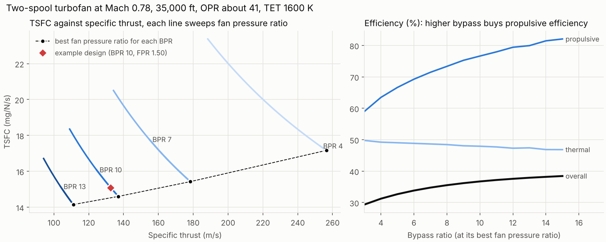

# gtperf

A Python toolkit for gas turbine performance: cycle modelling, site performance prediction, pass-off test validation and fleet trend analysis, for industrial and aero engines.

**Status:** v1.2.0. All six phases done (design-point cycle; off-design and site performance; pass-off test validation; fleet analytics; tooling and reporting; two-spool turbofan, MATLAB port and certification note), and v1.2 works through every limitation listed in v1.1 (see [What v1.2 adds](#what-v12-adds)). Private.

## What phase 1 does

- **Real-gas properties.** Humid air and combustion products as ideal-gas mixtures, using NASA 7-coefficient polynomials (GRI-Mech 3.0 data). Enthalpies include heats of formation, so fuel LHV and the combustor energy balance come out of the same property model. Checked against Cantera to 1 part in a million.
- **Fuels.** Gaseous hydrocarbon blends (CH4, C2H6, C3H8 with CO2/N2 inerts), complete combustion, LHV and stoichiometric fuel-air ratio computed from composition.
- **Components.** Inlet duct, compressor (isentropic or polytropic efficiency), combustor (solves fuel flow for a target exit temperature, with pressure loss and combustion efficiency), turbine, and a simple turbine cooling-air model that separates TIT (combustor exit) from rotor inlet temperature.
- **Single-shaft simple cycle.** Station-by-station results, shaft and electrical power, thermal efficiency, heat rate, exhaust flow and temperature, inlet and exhaust installation losses, and sizing of air flow for a target output.
- **Parametric studies** over pressure ratio and firing temperature.
- **CLI** driven by a TOML engine definition.

## What phase 2 adds

- **Twin-shaft cycle** (gas generator plus free power turbine), the layout of most small industrial engines, alongside the single-shaft cycle.
- **Off-design matching.** A generic analytic compressor map (speed lines from surge to choke, efficiency fall-off with speed and incidence), Stodola ellipse-law turbine flow capacity, and turbine efficiency against blade-speed ratio. A Newton solver finds the point where compressor flow, both turbine capacities and the gas generator power balance agree. Corrected flow and speed use full γRT similarity, so humidity and fuel changes are handled consistently.
- **Base-load control.** Constant TIT, with a gas generator speed limit that takes over on cold days and lowers TIT ("speed topping").
- **Calibration to a public datasheet.** Air flow, TIT and turbine efficiency are fitted to the published SGT-400 13 MW ISO power, heat rate and exhaust flow. Exhaust temperature is left out of the fit and used as an independent check.
- **Site performance prediction.** ISA altitude, ambient temperature, humidity, inlet and exhaust losses, fuel composition and component degradation, with the change from ISO broken into correction factors that multiply exactly to the site value. Output as a markdown or CSV performance sheet.
- **Correction curves** across ambient temperature, plus a `Health` object (compressor flow and efficiency, turbine efficiency and capacity) that phases 3 and 4 build on.

## What phase 3 adds

- **Synthetic test-bed data.** A production engine with hidden build-to-build health deltas is "tested" at whatever the weather is on the day. A representative instrument set (redundant inlet RTDs, 12 exhaust thermocouples, Coriolis fuel flow, gas chromatograph LHV, power metering, barometer, humidity, inlet and exhaust pressure losses) logs at 1 Hz. Every sensor gets a hidden calibration bias and noise, and faults can be injected: offset, drift, stuck and spikes.
- **Data validation.** Spike removal (rolling median and MAD), stuck-sensor detection, redundant-sensor disagreement, exhaust thermocouple deviation and drift checks against the rest of the rake, and stability criteria on 1-minute averages.
- **Correction to reference conditions** by the model-ratio method used in performance test codes (ASME PTC 22 / ISO 2314 style). Exhaust flow is derived from a heat balance, since it cannot be measured directly.
- **Measurement uncertainty.** GUM first-order propagation with numerical sensitivities through the whole correction chain, plus a JCGM 101 Monte Carlo. Calibration errors are shared by all test points and random errors are independent per point, with an autocorrelation-corrected standard error. The budget also includes exhaust profile under-sampling when thermocouples are excluded, and correction-model uncertainty from production scatter.
- **Acceptance** against guarantee limits with guarded-band verdicts and probability of conformance. A test point is flagged as not valid when the engine ran in a different control mode from the reference (detected from measured gas generator speed).
- **Auto-generated test report** in markdown with figures.

## What phase 4 adds

- **Production SPC.** 200 synthetic pass-off results in build order with hidden events: a damaged engine, a test-bed metering error and a supplier change. The toolkit runs individuals, EWMA and CUSUM charts, Western Electric rules, a robust Phase I and Cpk against the acceptance limit.
- **Gas-path analysis.** An influence coefficient matrix taken from the engine model, weighted least-squares health estimation, fault fingerprints for components and sensors, sensor isolation by residual, and a nonlinear Gauss-Newton refit for large deviations.
- **In-service fleet monitoring.** A synthetic fleet of 12 engines over 2 years, with compressor fouling and washes, wear, UK-like weather and five injected engine and instrument faults. Each snapshot is compared with the nominal model through a baseline lookup. Two physics-based detectors run on the results: a trend-compensated step detector with an exact chi-squared statistic, and an instrument consistency monitor. Thresholds are tuned on one fleet and scored on an unseen one, against a naive data-driven detector.

## What phase 5 adds

- **Excel site performance tool.** `gtperf excel` writes a workbook for a non-specialist: five site cases side by side, input range checks, every correction factor visible, and the results. It uses plain formulas over correction tables generated from the full model, so it needs no Python and no macros, and stays within 0.2 % of the full model. See [excel/README.md](excel/README.md).
- **VBA module.** [excel/gtperf.bas](excel/gtperf.bas) adds worksheet functions (`GT_SITE`, `GT_ISA_PRESSURE` and others) and a `RunFullModel` macro that sends each case to the Python model.
- **Automated checks.** Ruff lint, 80 tests with 95 % line and branch coverage (`make check`), and a GitHub Actions workflow ready for when the repository is published. The workbook formulas and the VBA functions are tested by recalculating and running them in headless LibreOffice.
- **Technical report and slide deck**, kept as private documents outside the repository.


## What phase 6 adds

- **Two-spool turbofan design point.** Separate-exhaust turbofan with SAE station numbering, ISA atmosphere, a kerosene surrogate burned through the same real-gas property model, convergent nozzles that choke, and LP and HP spool power balances. `gtperf turbofan` reports thrust, TSFC, the thermal, propulsive and overall efficiencies and a station table, and sizes the engine to a thrust requirement. It is checked against the textbook constant-cp hand calculation to 1e-6, the ideal Brayton limit, first-law closure, and the classic optimum fan pressure ratio result V_bypass/V_core = ηfan·ηLPT.
- **MATLAB port.** [matlab/](matlab/) holds the property model, fuels, components, the SGT-400 twin-shaft cycle and the turbofan as MATLAB functions. `make matlab` runs them in Octave against reference values written by the Python package; they agree to about 1e-11.
- **Requirements and certification note.** [docs/requirements_and_certification.md](docs/requirements_and_certification.md) traces each guarantee and model requirement to its verification method and evidence, with a test that fails if the trace goes stale. It then sets out how emissions limits (Medium Combustion Plant Directive; ICAO Annex 16 LTO cycle) and Chapter 14 noise constrain the two cycles, with the bypass ratio trade computed from the model.



## What v1.2 adds

v1.1 listed twelve limitations. Each one is now modelled, checked or measured, and what remains is stated in [Limitations](#limitations).

- **Real component maps, guide vanes and bleed.** The public NPSS HBTF compressor and turbine maps (from NASA pyCycle, Apache 2.0, see [NOTICE](src/gtperf/data/maps/NOTICE)) replace the analytic map, read by R-line and scaled to the design point. VIGV angle shifts flow, head and efficiency on the map, and VIGV and handling-bleed schedules follow corrected speed. With the real map the gas generator slows on cold days, so a corrected-speed limit now joins the mechanical one.
- **Split cooling.** NGV, rotor and power turbine cooling streams, with the power turbine air taken from an interstage port, so it costs less compressor work than delivery air.
- **Losses that scale with flow.** Inlet and exhaust losses scale with dynamic head, W²T/P, from their design values.
- **Part load and limits.** `power=` or `load=` sets any operating point. The twin shaft lowers TIT; the single shaft closes its VIGVs to hold exhaust temperature, then lowers TIT at the vane stop. Base load is the first limit reached among TIT, both gas generator speed limits, exhaust and PT inlet temperature, shaft power and a generator capability curve with ambient derate.
- **Multi-point calibration.** [testbed.py](src/gtperf/testbed.py) fits model parameters to a whole test campaign by weighted least squares, with parameter covariance, condition number, chi-square and held-out prediction. It shows that the HP and power turbine efficiencies cannot be separated without the inter-turbine pressure (correlation −0.98, falling to −0.36 with P45). See [docs/calibration/multipoint.md](docs/calibration/multipoint.md).
- **Humidity check.** The humidity effect is checked against GE's GER-3567H (a single shaft on exhaust temperature control loses power with humidity; an aeroderivative gains it as the gas generator speeds up) and against Yu, Lin and Yu (2025). See [docs/humidity_check.md](docs/humidity_check.md).
- **Sourced pass-off uncertainties and estimated scatter.** Every instrument's uncertainty comes from its standard class or datasheet ([instruments.toml](src/gtperf/data/instruments.toml)) or from a calibration certificate, with due dates checked. Production scatter is estimated from the build data with confidence intervals instead of being assumed.
- **Exhaust profile that moves.** The exhaust temperature field has burner-by-burner structure whose swirl rotates with load, so the rake profile uncertainty is a Monte Carlo over that model, and a weak burner is detected and tracked across load.
- **Fault isolation.** HP and power turbine health are separate parameters, the GPA takes any measurement set (T45 and P45 added), and influence matrices can be built at part load. [docs/gpa_observability.md](docs/gpa_observability.md) measures which faults the measurements can tell apart and shows a second snapshot at part load is the most effective cure.
- **Part-load fleet monitoring.** Cycling units follow a dispatch profile; part-load snapshots are compared with a baseline read at the measured output and analysed with a part-load influence matrix, with a power meter fingerprint for the setting. See section 2 of [docs/fleet/report.md](docs/fleet/report.md).
- **Turbofan off-design and transients.** Fan, booster, HPC and turbine maps, working lines, thrust lapse with altitude and Mach number, thrust, N1, TET and fuel-flow settings, an idle to take-off acceleration with spool inertias, split cooling and a convergent-divergent nozzle option.
- **Emissions and noise.** A DLE combustor model (Zeldovich NOx, CO burnout, air staging) calibrated to the SGT-400's published emissions, checked against the EU Medium Combustion Plant Directive across load; LTO-cycle NOx (Dp/Foo) for the turbofan against the CAEP/6 and CAEP/8 standards; and fan broadband (Heidmann) and jet mixing (Lighthill and von Glahn) source levels. See [docs/environment.md](docs/environment.md).

## Quick start

```bash
pip install -e ".[dev]"
gtperf design examples/engine_13mw.toml       # or: python -m gtperf design ...
python examples/parametric_study.py           # regenerates docs/figures/
gtperf calibrate examples/sgt400_13mw.toml
gtperf site examples/sgt400_13mw.toml examples/site_hot_desert.toml
gtperf curves examples/sgt400_13mw.toml > curves.csv
gtperf excel examples/sgt400_13mw.toml site_tool.xlsx
python examples/site_performance.py           # correction curves, site sheet
python examples/passoff_test.py               # synthetic pass-off test and report
python examples/coverage_study.py 100         # does U95 really cover 95 %?
python examples/fleet_analysis.py             # production SPC and fleet monitoring (a few minutes)
gtperf turbofan examples/turbofan_cruise.toml # two-spool turbofan at cruise
python examples/turbofan_study.py             # bypass ratio and fan pressure ratio trade
python examples/turbofan_offdesign.py         # turbofan working lines, thrust lapse, acceleration
python examples/multipoint_calibration.py     # test-bed calibration with uncertainty
python examples/humidity_check.py             # humidity effect against published behaviour
python examples/observability_study.py        # which faults the gas-path measurements can isolate
python examples/environment_study.py          # NOx/CO across load, LTO NOx, noise sources
make matlab                                   # MATLAB port, run in Octave against Python
make requirements                             # regenerate the traceability table
make check                                    # lint, tests and coverage
```

Example output for the illustrative 13 MW class engine at ISO conditions (15 °C, 1.01325 bar, 60 % RH):

```
electrical_power_MW             12.929
thermal_efficiency_pct          36.311
heat_rate_kJ_per_kWh          9914.356
exhaust_flow_kg_s               39.750
exhaust_temp_C                 527.001
```

From Python:

```python
from gtperf import SimpleCycle, Compressor, Combustor, Turbine, Ambient, natural_gas

cycle = SimpleCycle(
    Compressor(pressure_ratio=16.8, efficiency=0.90),        # polytropic
    Combustor(natural_gas(), t_out=1523.15),                 # TIT 1250 C
    Turbine(efficiency=0.89),
    cooling_fraction=0.15,
)
iso = cycle.run(air_flow=39.0)
hot = cycle.run(air_flow=39.0, ambient=Ambient(t=308.15))   # 35 C day
print(iso, hot.electrical_power / 1e6)
```

## Results


The classic simple-cycle trade-off: specific work (and so engine size for a given output) peaks at a much lower pressure ratio than thermal efficiency does, and both rise with firing temperature. Small industrial engines sit between the two optima.


### Calibration to the SGT-400 13 MW datasheet

Datasheet values from the [Siemens Energy SGT-400 product page](https://siemens-energy.com/us/en/home/products-services/product/sgt-400.html) (simple cycle, 13 MW version, ISO). Compressor polytropic efficiency 0.89, cooling air split 7 % NGV, 5 % rotor and 3 % power turbine (from an interstage port), 4 % combustor loss and 98 % generator efficiency are assumptions.

| Quantity | Datasheet | Model | Error |
|---|---:|---:|---:|
| Electrical power (MW) | 12.9 | 12.9 | fitted |
| Heat rate (kJ/kWh) | 10,294 | 10,294 | fitted |
| Exhaust flow (kg/s) | 40.0 | 40.0 | fitted |
| Exhaust temperature (°C) | 555 | 550.3 | −4.7 K (not fitted) |

Fitted values: air flow 39.2 kg/s, TIT 1280 °C, turbine isentropic efficiency 0.869. These depend on the assumptions above, so they are model parameters, not claims about the real engine.


Output falls by about 0.9 % per kelvin above ISO, while heat rate and exhaust temperature rise. Below about −8 °C the gas generator reaches its corrected-speed limit (shaded), so TIT is cut back and the curves change slope. With the NPSS compressor map the gas generator slows on cold days at constant TIT, so it is the corrected speed, not the mechanical speed, that limits there.


The full sheet for this example site is in [docs/site_hot_desert.md](docs/site_hot_desert.md).

### Pass-off test example

[docs/passoff/report.md](docs/passoff/report.md) is the generated report for engine ESN-0412. It was tested on an 8 to 9 °C day with four injected sensor faults, and the raw log is alongside it. Validation catches all four faults, and the engine passes all three limits. Every uncertainty in the budget names its source (standard class, datasheet or calibration certificate, with due dates checked). Because the data is synthetic, the report ends by comparing the corrected results with the hidden truth: every result lands within its U95.


### Does the stated uncertainty mean what it says?

`examples/coverage_study.py` repeats the test 100 times with fresh biases, noise, engine health and weather, and counts how often the truth falls inside the 95 % interval.

The first version covered only 80 % for corrected power. The cause was the correction itself, not the instruments. The correction curves describe the nominal engine, but every production engine responds slightly differently to ambient conditions. The error was worst on cold days, when a slightly different engine hits the gas generator speed limit at a different temperature. Two fixes followed: a correction-model uncertainty term driven by production scatter, and a check that refuses tests run in a different control mode from the reference. In v1.2 the instrument uncertainties come from standards, datasheets and certificates, the scatter is estimated from the production data, and the exhaust profile term comes from a Monte Carlo over a burner-pattern model. U95 for corrected power fell from ±0.048 MW to ±0.016 MW on the example test, and coverage still holds:

| Result | Coverage of U95 (100 valid tests) | Std of normalised error |
|---|---:|---:|
| Corrected power | 97 % | 0.84 |
| Corrected heat rate | 93 % | 1.06 |
| Corrected exhaust temperature | 96 % | 1.02 |
| Corrected exhaust flow | 93 % | 1.12 |

With 100 tests the standard error of a 95 % coverage is about 2 points, so all four are consistent with 95 %. None of these 100 tests ran on a speed limit; a pooled run of about 300 tests during development gave 93 to 95 %.

### Fleet analytics results

Full write-up: [docs/fleet/report.md](docs/fleet/report.md).

- **Production.** The CUSUM chart flags the supplier change 6 builds after it happens and EWMA after 7, while the Shewhart chart needs 28. Gas-path analysis of the shift points to compressor efficiency, which is the true cause. Cpk against the acceptance limit falls from 1.51 to 1.03.
- **In service (unseen test fleet).** All 5 faults are detected and all 5 correctly named: turbine blade damage, nozzle erosion, inlet filter failure, a drifting exhaust thermocouple and a fuel meter error. There are no false alarms in 24 engine-years. The naive detector also finds the faults, but it cannot name them and raises 0.75 nuisance alarms per engine-year.


Getting there took three fixes, each found by looking at false alarms:

1. Compressor washes had to be modelled as steps in each engine's trend.
2. The test statistic had to use the true prediction variance of the trend fit and the correlated error from the ambient temperature sensor.
3. Large genuine faults had to be refitted with the nonlinear model before being blamed on an instrument.

## Verification

The tests in `tests/` check:

| Check | Reference |
|-------|-----------|
| Constant-cp cycle with separate air and gas properties matches the hand calculation to 1e-6 | Textbook method (Saravanamuttoo, *Gas Turbine Theory*, ch. 2) |
| Lossless cycle recovers the ideal Brayton efficiency 1 − r^−(γ−1)/γ | Analytical |
| First law closes across the whole engine to 1e-9, with cooling air | Energy balance |
| Mass and element balances through the combustor | Conservation |
| Air cp at 300, 500, 1000 K within 0.5 % | Ideal-gas air tables |
| Methane LHV 50.0 MJ/kg, stoichiometric AFR 17.2 | Published values |
| Mixture cp, h and s identical to Cantera | Cantera / GRI-Mech 3.0 |
| Expected trends: TIT, pressure ratio optima, hot day, installation losses | Physical behaviour |
| Off-design solver reproduces the design point to 1e-8 (single and twin shaft) | Consistency |
| Dry-air output scales exactly with ambient pressure; heat rate unchanged | Non-dimensional similarity |
| Cold day switches to gas generator speed control and lowers TIT | Control logic |
| Hot day: lower output and flow, higher heat rate and exhaust temperature | Physical behaviour |
| Site correction factors multiply exactly to the site/ISO ratio | Consistency |
| Calibration hits datasheet targets; exhaust temperature within 10 K | SGT-400 datasheet |
| With perfect instruments, the correction returns the model reference values | Consistency |
| Validation catches every injected fault and raises no flags on clean data | Synthetic faults |
| Corrected results fall within U95 of the hidden truth | Synthetic truth |
| GUM and Monte Carlo standard uncertainties agree within 15 % | JCGM 100 / 101 |
| Speed-limited cold-day test is flagged as not valid | Control-mode check |
| CUSUM and EWMA detect a 1-sigma shift sooner than Shewhart | SPC theory |
| Linear GPA recovers health exactly from linear deltas; isolates a sensor bias | Consistency |
| Nonlinear GPA explains a large fault that linear GPA cannot | Engine model |
| Baseline lookup matches the engine model to 0.05 % | Consistency |
| Small fleet: step fault and sensor fault both detected and correctly isolated | Synthetic truth |
| Excel correction method within 0.3 % of the full model, on and off the table grid | Full model |
| Workbook formulas (recalculated in LibreOffice) and VBA functions (run in its VBA mode) match the Python mirror to 1e-9 | Consistency |
| VBA site-file writer and CSV reader round-trip through the real CLI | Consistency |
| Constant-cp turbofan matches the hand calculation to 1e-6, including a choked core nozzle | Textbook method (Saravanamuttoo, ch. 3) |
| Lossless turbofan recovers 1 − 1/(τr·τc) at bypass ratios 0 and 5 | Analytical |
| First law closes through the turbofan; nozzles conserve total enthalpy | Energy balance |
| At the best fan pressure ratio, V_bypass/V_core = ηfan·ηLPT within 0.015 | Classic optimum (polytropic efficiencies) |
| Higher bypass ratio gives lower TSFC and specific thrust | Physical behaviour |
| ISA temperature and pressure at 0, 11 and 20 km | ISA tables |
| MATLAB port matches the Python reference values to 1e-8 | Consistency |
| Every test named in the requirements file exists, and the traceability table is current | Consistency |
| Tabulated maps pass through the design point after scaling | Consistency |
| Cold day hits the corrected-speed limit; hot day the mechanical speed limit | Control logic |
| Generator capability and exhaust temperature limits bind when set | Control logic |
| VIGVs close at low corrected speed along the schedule | Control schedule |
| Twin-shaft part load lowers TIT; single shaft holds exhaust temperature with VIGVs, then lowers TIT | Control logic |
| Inlet and exhaust losses scale with W²T/P | Fluid mechanics |
| Humidity raises twin-shaft output and lowers single-shaft output on exhaust temperature control | GER-3567H |
| Multi-point fit recovers hidden parameters; held-out points within uncertainty; turbine efficiencies flagged as confounded | Synthetic truth |
| Every instrument has a source; class tolerances convert correctly; out-of-date certificates are flagged | Standards and datasheets |
| Estimated build scatter contains the hidden truth | Synthetic truth |
| Swirl rotates the burner cold spot by the modelled angle; a lean burner is detected and tracked | Exhaust model |
| Split HP/PT health and part-load influence matrices; part-load fleet deltas are unbiased | Consistency |
| Turbofan off-design reproduces the design point, lapses thrust with altitude and Mach, and accelerates to the steady point | Consistency, physical behaviour |
| Split turbofan cooling conserves mass and energy; the CD nozzle beats the convergent one only when choked | Conservation, gas dynamics |
| NOx follows the Zeldovich activation temperature; staging extends compliant turndown | Combustion chemistry |
| NOx standard continuous and matches the tabulated values | 40 CFR 1031.60 |
| Noise sources follow known turbofan trends (jet dominates at take-off, fan at approach) | Published behaviour |

## Limitations

The v1.1 limitations are all addressed (see [What v1.2 adds](#what-v12-adds)). What is still true:

- **No real engine data.** The NPSS maps are public research maps scaled to this engine, not the SGT-400's. The multi-point calibration, pass-off, fleet and fault-isolation studies run on synthetic data from a hidden "true" engine, so they demonstrate the methods, not this engine's numbers.
- **Some inputs are calibrated or illustrative.** The DLE staging stop is set to give the published 30 % turndown, the turbofan NOx reference index is illustrative, the calibration certificates are made-up records, the ISO 6976 heating-value uncertainty comes from a worked example, and the exhaust swirl relation and the field T45 and P45 noise levels are assumptions.
- **Noise is source levels only.** Fan broadband and jet mixing at 1 m, not certification EPNdB (no spectra, directivity, flight path, absorption or tone corrections), and fan tones are not modelled. The Heidmann constants were read from a scanned report.
- **No aero CO model.** Turbofan emissions cover NOx and CO2 only.
- **Linear, single-fault isolation.** The observability study scores one fault at a time; simultaneous faults rely on the weighted least-squares estimate and a prior.
- **Part-load instrument check.** At part load the consistency check has one degree of freedom, so instrument faults are named from base-load points only.

## Roadmap

1. Design-point cycle (done)
2. Off-design matching, site performance and calibration to a public datasheet (done)
3. Pass-off test validation with measurement uncertainty (done)
4. Fleet analytics: SPC, gas-path analysis and fault detection (done)
5. Tooling and reporting: Excel/VBA front end, CI, technical report and deck (done)
6. Stretch: MATLAB port, two-spool aero cycle, requirements and certification note (done)
7. v1.2: real maps, part load, multi-point calibration, sourced uncertainties, fault isolation, part-load fleet monitoring, turbofan off-design, emissions and noise (done)

All data in this project is synthetic or from public sources.
