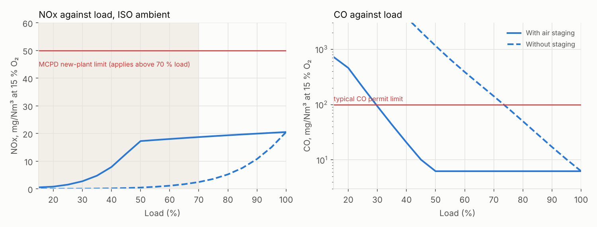

# Emissions and noise

## Industrial engine: DLE NOx and CO across load

The SGT-400 model's DLE combustor is calibrated to the published < 10 ppmvd NOx at ISO base load and an assumed 5 ppmvd CO. The premixed flame then runs at 1797 K. NOx is 20.5 mg/Nm³ at 15 % O₂ against the Medium Combustion Plant Directive's 50 mg/Nm³ for new gas turbines on natural gas, which applies above 70 % load.

| Load | Output (MW) | Flame (K) | Premix air | NOx (ppmvd) | NOx (mg/Nm³) | CO (mg/Nm³) | Compliant |
|---:|---:|---:|---:|---:|---:|---:|:---:|
| 100 % | 12.89 | 1797 | 0.75 | 10.0 | 20.5 | 6.2 | yes |
| 90 % | 11.60 | 1797 | 0.71 | 9.7 | 20.0 | 6.2 | yes |
| 80 % | 10.31 | 1797 | 0.67 | 9.4 | 19.4 | 6.2 | yes |
| 70 % | 9.02 | 1797 | 0.63 | 9.1 | 18.7 | 6.2 | yes |
| 60 % | 7.73 | 1797 | 0.59 | 8.8 | 18.0 | 6.2 | yes |
| 50 % | 6.44 | 1797 | 0.56 | 8.4 | 17.3 | 6.2 | yes |
| 40 % | 5.16 | 1737 | 0.55 | 3.8 | 7.9 | 20.6 | yes |
| 30 % | 3.87 | 1662 | 0.55 | 1.3 | 2.7 | 93.2 | yes |
| 20 % | 2.58 | 1582 | 0.55 | 0.4 | 0.8 | 459.3 | no |

Emissions-compliant down to 30 % load with air staging (Siemens Energy publishes 30 % for the SGT-400, and the staging stop was set to match it), and only to 75 % without, because the flame cools with TIT and CO climbs.

## Aero engine: LTO NOx

Rated thrust 118.9 kN at take-off TET 1750 K, rated pressure ratio 36.7. Take-off EI calibrated to an illustrative 30 g/kg.

| Mode | Thrust (kN) | T3 (K) | P3 (bar) | EI NOx (g/kg) | Fuel (kg) | NOx (g) |
|---|---:|---:|---:|---:|---:|---:|
| Take-off | 118.9 | 863 | 37.0 | 30.0 | 38.3 | 1149 |
| Climb | 101.1 | 821 | 31.5 | 22.0 | 95.7 | 2101 |
| Approach | 35.7 | 652 | 13.5 | 5.6 | 55.7 | 313 |
| Taxi/idle | 8.3 | 523 | 5.7 | 1.8 | 126.3 | 225 |

Dp/Foo = 31.9 g/kN against 63.4 (CAEP/8, tier 8) and 72.3 (CAEP/6, tier 6): a margin of 50 % to CAEP/8. LTO fuel 316 kg, CO2 999 kg.

## Aero engine: noise sources

Source levels in dB re 20 µPa at 1 m (fan: Heidmann peak broadband; jets: Lighthill/von Glahn sound power as an omnidirectional level).

| Source | Take-off | Approach (30 %) |
|---|---:|---:|
| Fan inlet broadband | 125.1 | 115.1 |
| Fan discharge broadband | 126.6 | 116.6 |
| Core jet mixing | 144.6 | 110.4 |
| Bypass jet mixing | 132.4 | 112.8 |
| Total | 145.0 | 120.4 |

Fan tip relative Mach 1.20 at take-off and 0.70 at approach. The core jet dominates at take-off and the fan at approach, the known pattern for a high-bypass turbofan. These are source levels for trade studies; certification EPNdB would also need spectra, directivity, the flight path, atmospheric absorption, perceived-noise weighting and tone corrections.
