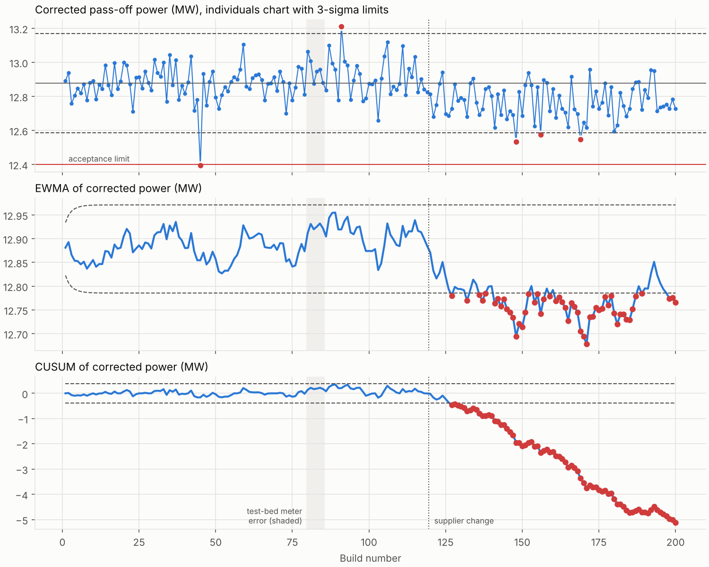

# Fleet performance monitoring

Synthetic data from the calibrated SGT-400-class model. Two problems: watching production pass-off results build by build, and watching engines in service for faults.

## 1. Production pass-off SPC

200 engines in build order, each with build-to-build component scatter and pass-off measurement error. Three events are hidden in the data:

- Build 45: Engine damaged during build (turbine efficiency -1.0 pts)
- Build 80–85: Test-bed power metering error (+0.6 %)
- Build 120 onwards: Supplier change: compressor efficiency -0.3 pts

Phase I limits from builds 1–50 (outliers removed): centre 12.878 MW, sigma 0.097 MW. Individuals chart signals at builds [45, 91, 148, 156, 169].

| Chart | First signal after the supplier change (build 120) | Builds to detect |
|---|---:|---:|
| Individuals (Shewhart) | 148 | 28 |
| EWMA | 127 | 7 |
| CUSUM | 127 | 7 |

Gas-path analysis of the mean delta change across build 120 points to **compressor efficiency** (match 0.998; next turbine efficiency 0.957). Build 45 matches **turbine efficiency** (0.998).

Process capability against the 12.4 MW acceptance limit: Cpk 1.72 before the change, 1.22 after.

The +0.6 % power metering error on builds 80–85 is too small to see in power alone (about half a sigma). It shows up in heat rate instead, because the meter reads high while fuel flow is unaffected.

## 2. In-service fleet monitoring

Twelve engines on site for two years, with base-load snapshots every two days. Compressors foul and are washed every 100–140 days, components wear slowly, and the weather follows a UK-like seasonal cycle. Each snapshot is compared with the nominal model at the same ambient conditions.

Two physics-based detectors run on the deltas:

- **Step detector.** It compares the last 8 snapshots with the engine's own trend over the 20 before, with known washes modelled as steps. The statistic is chi-squared with 6 degrees of freedom when nothing has changed, using the exact prediction variance of the trend fit and the correlated error from the ambient temperature sensor. Gas-path fingerprints name the most likely cause.
- **Instrument consistency monitor.** It checks whether the smoothed deltas can be explained by any combination of component changes (generalised least squares residual). A drifting sensor cannot, and removing one sensor at a time names it. Large real engine faults are refitted with the full nonlinear model before being called an instrument fault.

Snapshots with the gas generator on its speed limit (cold days) are excluded, because the nominal baseline is on temperature control there.

### Choosing the threshold on a training fleet

| Step threshold | Faults detected | Correctly isolated | False alarms per engine-year |
|---:|---:|---:|---:|
| 20.0 | 5.0 / 5.0 | 4.0 | 0.38 |
| 25.0 | 4.0 / 5.0 | 4.0 | 0.04 |
| 30.0 | 4.0 / 5.0 | 4.0 | 0.00 |

A threshold of 25 was chosen. It sits about 3e-4 into the chi-squared tail.

### Results on an unseen test fleet

This fleet has different random seeds and different faults on different engines and days.

| Engine | Fault | Detected after (days) | Isolated as | Correct |
|---:|---|---:|---|---|
| 2 | HP turbine blade damage | 2 | turbine efficiency | yes |
| 6 | HP turbine nozzle erosion | 6 | hp turbine flow capacity | yes |
| 9 | Inlet filter failure, rapid fouling | 16 | compressor efficiency | yes |
| 4 | Exhaust thermocouple drift | 92 | egt sensor | yes |
| 11 | Fuel meter calibration error | 20 | fuel_flow sensor | yes |

False alarms: 0 in 24 engine-years (0.00 per engine-year).

### Compared with a naive data-driven detector

A Hotelling T² outlier test on each engine's rolling-mean deltas against the fleet's spread in the first 90 days has no physics and no knowledge of washes.

| Detector | Faults detected | Can name the cause | False alarms per engine-year |
|---|---:|---|---:|
| Physics-based (step + consistency) | 5 / 5 | yes | 0.00 |
| Naive T² outlier | 5 / 5 | no | 0.25 |

The naive detector mostly flags engines that are simply dirtier or more worn than the fleet was early on. That is real but expected, so it produces nuisance alarms, and it cannot tell a sensor fault from an engine fault.

### Cycling units: monitoring at part load

The same faults on engines that follow a dispatch profile: base load on 46 % of snapshots, otherwise 55–95 % load. Monitoring only base-load points throws the rest away. At part load the output is the operator's setting, so the baseline is read at the measured output, the power delta is zero by construction, and an influence matrix built at part load (power excluded) explains the other five deltas. A power meter error then appears as the engine running at a different output than the baseline assumes, and its fingerprint is the change in the other deltas per percent of output; the meter's own noise is carried into the step detector's covariance for the same reason. The two streams are monitored separately per engine and their alarms merged.

| Engine | Fault | Base load only: detected after (days) | Base + part load | Isolated as (base + part) |
|---:|---|---:|---:|---|
| 2 | HP turbine blade damage | 2 | 2 | turbine efficiency |
| 6 | HP turbine nozzle erosion | 24 | 6 | hp turbine flow capacity |
| 9 | Inlet filter failure, rapid fouling | 28 | 26 | compressor efficiency |
| 4 | Exhaust thermocouple drift | 56 | 56 | egt sensor |
| 11 | Fuel meter calibration error | 48 | 48 | fuel_flow sensor |

False alarms per engine-year: 0.04 base load only, 0.04 with part load.

The instrument consistency check runs on base-load points only: at part load five free measurements and four health parameters leave one degree of freedom, enough to see an inconsistency but not to name the sensor.

## Limitations

- The compressor and lumped turbine efficiency fingerprints are similar, so a small fault in one is easily confused with the other. The split-turbine study in [gpa_observability.md](../gpa_observability.md) shows a second snapshot at part load is the most effective cure with the existing instruments.
- Compressor flow capacity only shows in gas generator speed on this twin-shaft engine at temperature control, so fouling flow loss is weakly observable.
- Gradual sensor drifts are invisible to the step detector by design (it follows trends), which is why the consistency monitor exists.
- Everything is synthetic, and the field instrument noise levels are assumptions.
