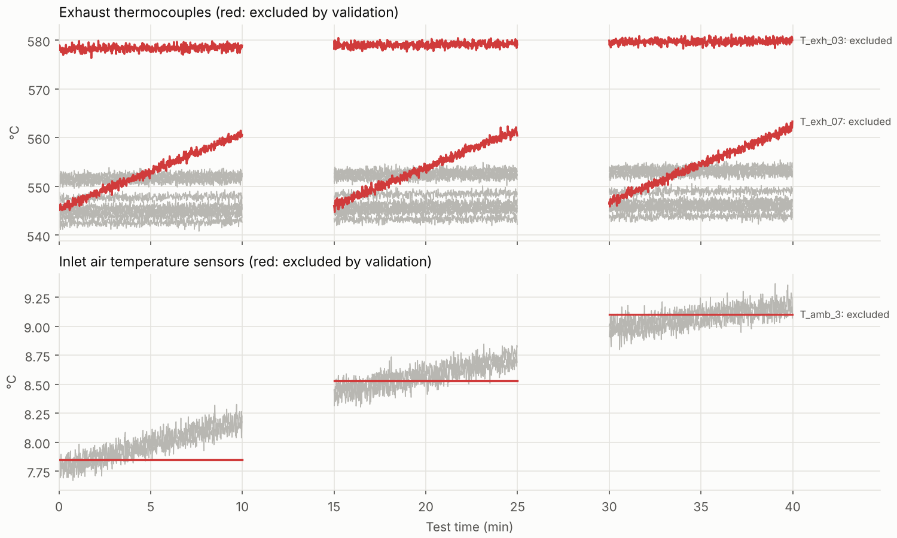
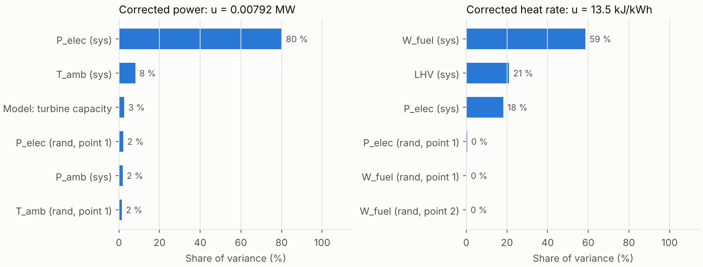
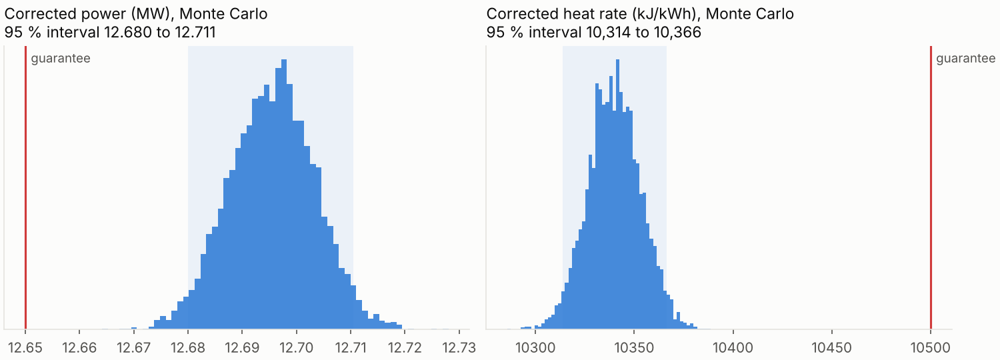
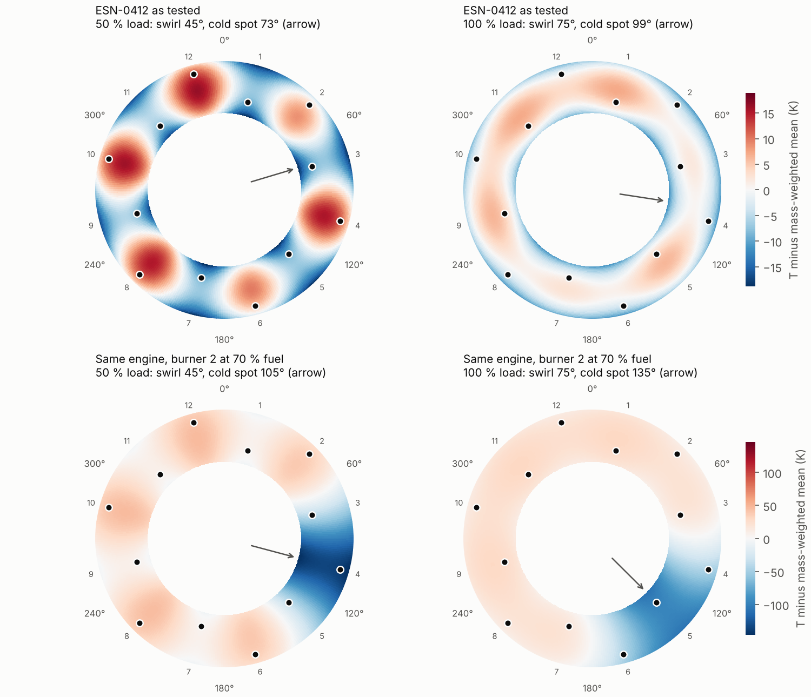

# Pass-off test report: ESN-0412

**Overall result: PASS** against the acceptance limits below, on 3 test points at base load. Fuel: natural gas. Test date: 2026-10-12.

> Note: N_gg (Tachometer accuracy): certificate TB2-SPD-2506-01 is out of date (calibrated 2025-06-30, due 2026-06-30, test 2026-10-12). The class tolerance was used instead and no certificate correction was applied. Diagnostic channel only; results unaffected.

## 1. Corrected results against acceptance limits

Corrected to reference conditions (ISO 15 °C, 1013.25 mbar, 60 % RH, no inlet or exhaust losses). U95 is the expanded uncertainty (k = 2).

| Result | Corrected | U95 | Limit | Margin | P(conform) | Verdict |
|---|---:|---:|---:|---:|---:|---|
| Corrected power (MW) | 12.695 | ±0.016 | >= 12.650 | 0.045 | 100.0 % | PASS |
| Corrected heat rate (kJ/kWh) | 10,340 | ±27 | <= 10,500 | 160 | 100.0 % | PASS |
| Corrected exhaust temperature (°C) | 552.8 | ±1.4 | <= 570.0 | 17.2 | 100.0 % | PASS |
| Corrected exhaust flow (heat balance) (kg/s) | 39.44 | ±0.18 | – | – | – | for information |

## 2. Test conditions

| Point | Samples | Ambient (°C) | Pressure (mbar) | RH (%) | Inlet loss (mbar) | Exhaust loss (mbar) |
|---:|---:|---:|---:|---:|---:|---:|
| 1 | 600 | 7.99 | 1001.9 | 78.3 | 5.0 | 12.0 |
| 2 | 600 | 8.59 | 1002.1 | 76.3 | 5.0 | 12.0 |
| 3 | 600 | 9.09 | 1002.2 | 74.3 | 5.0 | 12.0 |

## 3. Data validation

| Sensor | Excluded because |
|---|---|
| T_amb_3 | stuck (no change for 60+ samples) |
| T_exh_03 | reads 29.0 K from the exhaust median |
| T_exh_07 | drifts 13.6 K relative to other thermocouples |

Spikes removed: P_elec (18 samples).

Stability (range of 1-minute averages within each point): all within limits.

## 4. Measured and corrected results by point

| Point | Measured power (MW) | Measured heat rate (kJ/kWh) | Power correction | Heat rate correction | Corrected power (MW) | Corrected heat rate (kJ/kWh) |
|---:|---:|---:|---:|---:|---:|---:|
| 1 | 13.272 | 10,250 | 0.9566 | 1.0088 | 12.695 | 10,340 |
| 2 | 13.191 | 10,266 | 0.9623 | 1.0072 | 12.694 | 10,339 |
| 3 | 13.129 | 10,280 | 0.9672 | 1.0059 | 12.698 | 10,340 |

Point-to-point repeatability of corrected power: 0.03 % (max − min). This engine produced -1.50 % power against the nominal model at test conditions.

## 5. Uncertainty

Systematic (calibration) uncertainties are shared by all points; random uncertainties are the standard error of each point mean, with an effective sample size for autocorrelation. Sensitivities are found numerically through the full correction chain, including the engine model.

| Result | GUM u | Monte Carlo u | MC 95 % interval |
|---|---:|---:|---|
| Corrected power (MW) | 0.007925 | 0.007858 | 12.680 to 12.711 |
| Corrected heat rate (kJ/kWh) | 13.5 | 13.43 | 10,314 to 10,366 |
| Corrected exhaust temperature (°C) | 0.6959 | 0.7028 | 551.4 to 554.2 |
| Corrected exhaust flow (heat balance) (kg/s) | 0.0919 | 0.0911 | 39.26 to 39.62 |

Largest contributors:

Exhaust temperature systematic uncertainty combines thermocouple calibration (0.40 K for the mean of 10 thermocouples) and rake profile sampling (0.57 K). The second is a Monte Carlo over the exhaust field model: burner fuel split deviations, swirl angle, lobe strength and radial profile drawn from their priors, the rake sampled at its 10 valid positions, and the rake mean compared with the mass-weighted mean. The expected offset of the rake mean, +0.33 K, was subtracted as a correction.

Burner check (rake, before sensor exclusions): spread 35.8 K; coldest adjacent pair T_exh_01/T_exh_02 reads +1.7 K from the median; a cold spot needs it below -14.3 K (99.9th percentile for healthy engines from the profile model). No cold spot.

Burner diagnostic load survey: the rake is read at several loads and any cold spot is tracked. A burner cold spot rotates with load by the modelled swirl angle; a sensor fault stays put.

| Case | Loads | Cold spot depth / threshold (K) | Cold spot angle | Rotation measured / modelled | Verdict |
|---|---|---|---|---|---|
| ESN-0412 | 50 %, 100 % | -6 / 15, -0 / 14 | –, – | – | no burner fault detected |
| Burner 2 lean (70 % fuel) | 50 %, 100 % | 44 / 15, 62 / 14 | 105°, 135° | +30° / +30° | burner fault: cold spot near burner 2 rotates with load as the swirl model predicts |

### Instrument uncertainty sources

Each calibration uncertainty comes from the instrument's accuracy class or specification, or from its calibration certificate when one is in date for the test (the reading is then corrected by the as-found error). Class tolerances are converted to standard uncertainties with the stated distribution (rectangular: tolerance / √3). u is per channel at the test reading.

| Channels | Component | Basis | Tolerance or certificate | Distribution | u (k = 1) | Source |
|---|---|---|---|---|---:|---|
| T_amb_1 … T_amb_3 (3) | Pt100 element and readout (loop) | calibration certificates | TB2-RTD-2604-01: as-found +0.03, U = 0.05 (k = 2); TB2-RTD-2604-02: as-found -0.05, U = 0.05 (k = 2); TB2-RTD-2604-03: as-found +0.02, U = 0.05 (k = 2). Overrides IEC 60751 class A, ±(0.15 + 0.002·\|t\|) °C | normal (certificate) | 0.025 degC | [link](https://reotemp.com/2025/06/24/rtd-tolerance-classes-explained) |
| P_amb | Barometer total accuracy | Vaisala PTB330 specification class A, 500-1100 hPa, -40 to +60 °C | ±0.15 hPa | rectangular | 0.0866 mbar | [link](https://docs.vaisala.com/r/M210855EN-E/en-US/GUID-0A761DB8-D737-455F-B497-15DDB047E696) |
| RH | Humidity probe accuracy | Vaisala HMP155 specification -20 to +40 °C | ±(1.0 + 0.008·reading) %RH | rectangular | 0.93 % | [link](https://s.campbellsci.com/documents/au/product-brochures/b_hmp155.pdf) |
| dP_inlet | DP transmitter reference accuracy | Rosemount 3051S specification Classic performance class | ±0.035 % of calibrated span (span 25 mbar) | rectangular | 0.00505 mbar | [link](https://emerson.com:443/documents/automation/product-data-sheet-rosemount-3051s-series-of-instrumentation-en-73154.pdf) |
| dP_exhaust | DP transmitter reference accuracy | Rosemount 3051S specification Classic performance class | ±0.035 % of calibrated span (span 50 mbar) | rectangular | 0.0101 mbar | [link](https://emerson.com:443/documents/automation/product-data-sheet-rosemount-3051s-series-of-instrumentation-en-73154.pdf) |
| W_fuel | Coriolis gas mass flow accuracy | calibration certificate | TB2-FLOW-2602-07: as-found +0.12, U = 0.2 (k = 2). Overrides Micro Motion ELITE CMFS specification gas, ±0.25 % of rate | normal (certificate) | 0.1 % | [link](https://www.instrumart.com/products/42309/micro-motion-elite-coriolis-flow-meters) |
| LHV | Mass-basis heating value from composition | ISO 6976:2016 method u = 0.06 % (k = 1) | u = 0.030 / 48.977 MJ/kg | normal (bound taken as k = 1) | 0.06 % | [link](https://www.mdpi.com/2674-0389/4/1/1) (applicability not verified, see note) |
| P_elec | Current transformers (ratio and phase) | calibration certificate | TB2-CT-2511-01: as-found -0.03, U = 0.06 (k = 2). Overrides IEC 61869-2 class 0.2, ±(0.2 % + tan φ · 10′) at 100-120 % In, pf 0.9 → ±0.341 % | normal (certificate) | 0.03 % | [link](https://imsi.p.lodz.pl/sites/i25/files/2023-12/cw2_%20v0318.pdf) |
| P_elec | Voltage transformers (ratio and phase) | calibration certificate | TB2-VT-2511-02: as-found +0.02, U = 0.05 (k = 2). Overrides IEC 61869-3 (limits as in IEC 60044-2) class 0.2, ±(0.2 % + tan φ · 10′) at 80-120 % Un, pf 0.9 → ±0.341 % | normal (certificate) | 0.025 % | [link](https://www.kth.se/social/files/55f12ed5f2765409c53d3c14/2%20Instrument%20transformers.pdf) |
| P_elec | Active energy meter | calibration certificate | TB2-MTR-2603-03: as-found +0.04, U = 0.08 (k = 2). Overrides IEC 62053-22 class 0.2S, ±0.2 % (pf 1), ±0.3 % (pf 0.5 ind.) for 0.05-0.1 In ≤ I ≤ Imax; ±0.3 % used at pf 0.9 | normal (certificate) | 0.04 % | [link](https://assets.elexon.co.uk/wp-content/uploads/sites/11/2012/02/28171745/redlining_for_cp1319_cop4_v0.1.pdf) |
| T_exh_01 … T_exh_12 (12) | Thermocouple tolerance | IEC 60584-1 type K class 1 | ±1.5 °C (-40 to 375 °C) or ±0.004·\|t\| (375 to 1000 °C) | rectangular | 1.27 degC | [link](https://tcdirect.co.uk/thermocouple-sensors/thermocouple-accuracies.aspx) |
| N_gg | Tachometer accuracy | Bently Nevada 3500/50M specification 10,000-99,999 rpm | ±0.01 % of true shaft speed | rectangular | 0.00574 % | [link](https://core.instrumart.com/assets/3500-50M-Datasheet.pdf) |
| P3 | Pressure transmitter reference accuracy | Rosemount 3051S specification Classic performance class | ±0.035 % of calibrated span (span 25 bar) | rectangular | 0.00505 bar | [link](https://emerson.com:443/documents/automation/product-data-sheet-rosemount-3051s-series-of-instrumentation-en-73154.pdf) |
| T3 | Thermocouple tolerance | IEC 60584-1 type K class 1 | ±1.5 °C (-40 to 375 °C) or ±0.004·\|t\| (375 to 1000 °C) | rectangular | 0.974 degC | [link](https://tcdirect.co.uk/thermocouple-sensors/thermocouple-accuracies.aspx) |

Note on LHV: Standard uncertainty of the mass-basis superior calorific value for the worked example in van der Veen (VSL), Methane 4(1), 2025, with composition correlations. The author states the example is not intended to represent typical performance, and the LHV is assumed to have the same relative uncertainty. Replace with the site GC's own ISO 6976 / ISO 6974 uncertainty.

Calibration status on the test date:

| Channel | Certificate | Calibrated | Due | Status |
|---|---|---|---|---|
| T_amb_1 (Pt100 element and readout (loop)) | TB2-RTD-2604-01 | 2026-04-20 | 2027-04-20 | in date |
| T_amb_2 (Pt100 element and readout (loop)) | TB2-RTD-2604-02 | 2026-04-20 | 2027-04-20 | in date |
| T_amb_3 (Pt100 element and readout (loop)) | TB2-RTD-2604-03 | 2026-04-20 | 2027-04-20 | in date |
| W_fuel (Coriolis gas mass flow accuracy) | TB2-FLOW-2602-07 | 2026-02-03 | 2027-02-03 | in date |
| P_elec (Current transformers (ratio and phase)) | TB2-CT-2511-01 | 2025-11-18 | 2026-11-18 | in date |
| P_elec (Voltage transformers (ratio and phase)) | TB2-VT-2511-02 | 2025-11-18 | 2026-11-18 | in date |
| P_elec (Active energy meter) | TB2-MTR-2603-03 | 2026-03-09 | 2027-03-09 | in date |
| N_gg (Tachometer accuracy) | TB2-SPD-2506-01 | 2025-06-30 | 2026-06-30 | out of date |

Certificate corrections applied to the readings: T_amb_1 +0.030 degC, T_amb_2 -0.050 degC, T_amb_3 +0.020 degC, W_fuel +0.120 %, P_elec +0.030 % (as-found error subtracted).

### Correction-model scatter

Build-to-build health scatter used for the correction-model terms: estimated from 200 production pass-off tests (point estimates). Compressor flow 0.27 %, compressor efficiency 0.15 pts, turbine efficiency 0.12 pts, turbine capacity 0.30 % (one standard deviation).

| Parameter | Estimate | 95 % interval | Hidden truth (synthetic) |
|---|---:|---|---:|
| Compressor flow capacity (%) | 0.268 | 0.231 to 0.300 | 0.300 |
| Compressor efficiency (pts) | 0.152 | 0.127 to 0.176 | 0.150 |
| Turbine efficiency (pts) | 0.124 | 0.104 to 0.142 | 0.120 |
| HP turbine flow capacity (%) | 0.297 | 0.242 to 0.339 | 0.300 |
| Corrected power (MW) | 0.094 | 0.086 to 0.104 | 0.093 |

## 6. Check against the known truth (synthetic test only)

The data was generated from an engine with hidden health deltas and hidden instrument biases. A sound method should land within U95 of the truth about 95 % of the time.

| Result | True | Corrected | Error | Error / U95 |
|---|---:|---:|---:|---:|
| Corrected power (MW) | 12.684 | 12.695 | +0.012 | +0.75 |
| Corrected heat rate (kJ/kWh) | 10,358 | 10,340 | -19 | -0.69 |
| Corrected exhaust temperature (°C) | 552.2 | 552.8 | +0.6 | +0.45 |
| Corrected exhaust flow (heat balance) (kg/s) | 39.56 | 39.44 | -0.12 | -0.65 |

## Method notes

- Correction by the model-ratio method: corrected = measured × model(reference) / model(test). Exhaust temperature is corrected by difference.
- Exhaust flow comes from a heat balance on fuel heat input, electrical output and modelled mechanical and generator losses, then corrected the same way.
- Acceptance follows a guarded-band reading: PASS needs the margin to exceed U95; a smaller positive margin is reported as PASS (within uncertainty).
- Correction-model uncertainty: the correction curves describe the nominal engine, so the build-to-build scatter of component health (estimated from production pass-off history when available) is propagated through the correction. This term grows with the distance from reference conditions.
- Instrument uncertainties come from accuracy classes, manufacturer specifications and calibration certificates listed above. The certificates for this synthetic test bed are illustrative records.
- The exhaust rake reads a modelled exhaust field (burner streaks rotated by swirl and smeared by mixing, plus a radial profile). Its under-sampling uncertainty is a Monte Carlo over that model's priors.
